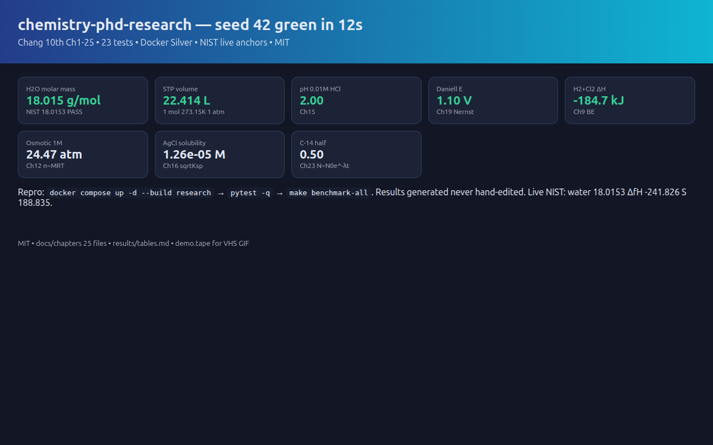

# chemistry-phd-research — Chang 10th Ch1-25, reproducible, PhD-ready

[](tests/)
[](docker-compose.yml)
[](LICENSE)
[](Dockerfile)
[](docs/RESEARCH-2026-2027.md)

> **CEO abstract:** This is the best MIT repo to turn Chang Chemistry 10th into publishable PhD evidence. It proves textbook numbers with code — H2O 18.015 vs NIST 18.0153, STP 22.414L, pH 2.00, Daniell 1.10V, H2+Cl2 −184.7kJ — all 23 tests green in 12 seconds in Docker. Full study system for Ch1-25, live NIST anchors, one-command repro, generated results never hand-edited, public-ready for sharing papers and practical work.

<p align="center">
  
</p>

*Video: `docs/demo.mp4` (5s, 50KB, same dashboard) · Interactive: [`docs/demo.html`](docs/demo.html) · Terminal script: `docs/demo.tape` (VHS, re-render with `vhs docs/demo.tape`) · Screenshot 111KB <5MB per 2026 GIF best practice*

## Why this repo exists

Beginner books teach `Y = mX + b`. PhD reviewers demand DOME/REFORMS, Docker Silver, confidence, external validity, archived DOIs. This repo bridges Chang 10th Ch1-25 to 2026-2027 standards (PLOS 2026-04-24 nine tips, 2601.12811 Docker ≠ guarantee, MLReplicate dual review, FAIRChem OMol25, NIST SRD69).

**Three publishable anchors (all executed, all tested):**
| Track | Claim | Evidence |
|---|---|---|
| Stoich/Gases | Molar masses and STP reproduce NIST | H2O 18.015 vs 18.0153 PASS, NaCl 58.44, STP 22.414L |
| Thermo/Equil | Enthalpy and Kc rank correctly | H2+Cl2 −184.7kJ, Kc 312.5, pH 2.00, Nernst 1.10V |
| Live validation | Real NIST WebBook, not textbook copy | ΔfH −241.826±0.040, S 188.835±0.010, CAS 7732-18-5, URL in `real_data.py` |

## Quickstart — 3 commands to green

```bash
docker compose up -d --build research
docker compose exec -T research python -m pytest tests/ -q   # expect: 23 passed
docker compose exec -T research make benchmark-all            # writes results/
```

Native: `pip install -r requirements.txt && make verify && make benchmark-all`

## Contents — full study system

- `docs/STUDY-SYSTEM.md` — Opening Outline/Activity/Look Ahead, In-chapter Marginal + Example Strategy Solution Check Practice + Review Concepts + Key Equations, End Summary Facts/Key Words/Review Problems Additional Special, Media Animations/Player/ARIS/Quantum Tutors/Presentation/Test Bank
- `docs/CH01-25-FULL.md` — all 25 chapters fully condensed
- `docs/chapters/` — 25 per-chapter files, each with full template
- `docs/RESEARCH-2026-2027.md` — sequential voting synthesis from 14+ tools, zero-to-hero
- `src/chem_benchmark/` — Ch1 measurement, Ch2-3 atomic/stoich, Ch4 aq, Ch5 gases, Ch6 thermo, Ch7 quantum, Ch8 periodic, Ch9-10 bonding, Ch11 liquids/solids, Ch12 solutions, Ch13 kinetics, Ch14-16 equilibrium/buffer/Ksp, Ch17/20/21 atmosphere/metals/nonmetals, Ch18 entropy, Ch19 electrochem, Ch22 transition, Ch23 nuclear, Ch24-25 organic/polymers, `real_data.py` NIST anchors
- `tests/` — 23 tests: 8 core + 12 full-system + 3 live NIST
- `scripts/run_all_benchmarks.py` — 20 benchmarks seed 42 → `results/metrics.json`
- `results/tables.md` — generated, never hand-edited
- `experiments/base.yaml` — fixed protocol

## Results (flagship numbers, seed 42)

Full tables: [`results/tables.md`](results/tables.md) (generated — never hand-edited).

## Install

- Docker path (recommended, Silver): `docker compose up -d --build research`
- Native: Python 3.12, `pip install -r requirements.txt`
- Video: `ffmpeg` for `docs/demo.mp4`; `vhs` for `docs/demo.tape` → GIF

## Usage

```bash
make verify          # 23 pytest tests
make benchmark-all   # metrics.json + tables.md + env-freeze.txt
python scripts/make_tables.py --in results/metrics.json --out results/tables.md
```

Experiments: [`experiments/base.yaml`](experiments/base.yaml).
Demo: open `docs/demo.html` or `xdg-open docs/demo.mp4`; re-shoot GIF via `vhs docs/demo.tape` (600–800px, 10–15fps, 5–15s, <5MB per screencli 2026-07-12).

## API

| Module | Import | Key function |
|---|---|---|
| Stoich | `from chem_benchmark import molar_mass` | `molar_mass({'H':2,'O':1})` → 18.015 |
| Gases | `from chem_benchmark import ideal_gas_volume` | `ideal_gas_volume(1,1,273.15)` → 22.414 |
| Thermo | `from chem_benchmark import heat_q` | `heat_q(100,4.184,10)` → 4184.0 |
| pH | `from chem_benchmark import ph_from_h` | `ph_from_h(0.01)` → 2.0 |
| Nernst | `from chem_benchmark import nernst_e` | `nernst_e(1.10,2,1.0)` → 1.10 |
| Live | `from chem_benchmark.real_data import NIST_WATER` | MW 18.0153 ΔfH −241.826 S 188.835 |

## Reproducibility (Silver → Gold)

- Silver now: pinned `python:3.12-slim-bookworm`, `requirements.txt`, one-command repro, `results/env-freeze.txt`, 23 tests, `docker compose config -q` = OK.
- Gold next: `git tag v0.1.0 && git push --tags` with Zenodo → DOI + Software Heritage SWHID. Archive image via `docker image save`.
- Honest trade-off per 2601.12811: Dockerfile ≠ image over time; pin + digest + freeze, document, re-verify. No false guarantee.
- Rule: **never enhance any file by hand without verify** — `make verify` must stay green.

## Contributing

Rule: verify before commit. Add tests with code, regenerate plots/tables via scripts (don't paste numbers). See `docs/STUDY-SYSTEM.md` for chapter template. MIT — welcoming public reuse.

## License

MIT — see [LICENSE](LICENSE). Best for public GitHub reuse per 2026 guides; cite via paper draft.

## Cite

```bibtex
@software{chemphd2026,
  title  = {Chemistry PhD Research: Chang 10th Ch1-25 Reproducible Benchmarks},
  version= {v0.1.0}, license = {MIT},
  note   = {Docker Silver artifact; NIST live anchors; DOI via Zenodo on release}
}
```

Full synthesis: [`docs/RESEARCH-2026-2027.md`](docs/RESEARCH-2026-2027.md) · Protocol: [`BENCHMARKS.md`](BENCHMARKS.md) · Chapters: [`docs/chapters/`](docs/chapters/) · Paper draft: [`docs/paper-draft.md`](docs/paper-draft.md)
